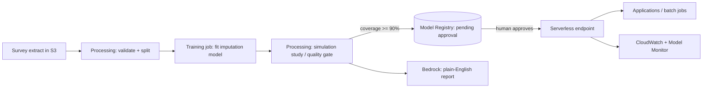

# income-imputation-aws

Multiple imputation of missing income in survey data, redesigned as an **end-to-end ML solution** that runs
locally, in a container, and on **Amazon SageMaker** with **Amazon Bedrock** for plain-English reporting.

It started as a BSc project (University of Essex, 2019-20: *Multiple Imputation for income in the UKHLS
study*, written in R with `mice`). This repository keeps the science and adds what a production system needs:
tests, reproducible pipelines, a deployable endpoint, monitoring, governance and cost control.

> **Status.** The Python package, simulation study, API server, SageMaker scripts and Bedrock client are
> covered by 56 automated tests that run locally with no AWS account. The Terraform, SageMaker Pipeline and
> endpoint scripts are written against the AWS APIs but have **not been run against a live AWS account yet**;
> see [docs/DEPLOY_AWS.md](docs/DEPLOY_AWS.md) for the checklist.

## What it does

* Imputes a missing continuous variable (wage) from age, sex, health, qualification, ethnicity, marital and
  job status, with **m = 5 plausible values** per person so uncertainty is carried through (Rubin's rules).
* Compares the **11 methods from the thesis** (`lm`, `mean`, `norm.predict`, `norm.nob`, `norm`,
  `norm.boot`, `pmm`, `midastouch`, `sample`, `cart`, `rf`) in a simulation study under MCAR, MAR and MNAR
  missingness, reporting raw bias, 95% coverage, interval width and RMSE.
* Packages the winner as a versioned model with a stable JSON API (`/ping`, `/invocations`).
* Uses Amazon Bedrock to turn the *aggregate* study metrics into a short explanation for non-technical readers.



## Quick start (no AWS needed)

```bash
python -m venv .venv && source .venv/bin/activate
pip install -e ".[dev]"
pytest                                           # 56 tests

# compare imputation methods on synthetic data that mimics the UKHLS extract
income-imputation simulate --n 3000 --n-sim 10 --methods all --mechanism mar --out artifacts/metrics.json

# train a model, then serve it exactly as SageMaker would
income-imputation train --method norm --out artifacts/model/model.joblib
MODEL_DIR=artifacts/model uvicorn income_imputation.serve:app --port 8080
curl -s localhost:8080/invocations -H 'content-type: application/json' -d '{"records":[{"age":38,"sex":"Female","health":"No","hiqual":"Degree","ethnic":"White","marriage":"Have partner","jb":"FT employed"}],"m":5}'

# report on the study (dry run prints a template; remove --dry-run to call Bedrock)
income-imputation explain --metrics artifacts/metrics.json --dry-run
```

Example result (synthetic data, MAR, 15% missing, 4 simulations): `mean` and `sample` imputation are badly
biased (coverage 0-25%), complete-case `lm` under-estimates the mean wage, while `norm`, `pmm` and
`norm.boot` are close to unbiased with about 100% coverage. This matches the theory in the thesis.

## Deploy on AWS

1. `cd infra/terraform && terraform init && terraform apply -var-file=example.tfvars` (bucket, role, registry, budget)
2. `make package` then `python mlops/pipeline.py --role-arn <role> --bucket <bucket> --start`
3. Review the metrics in SageMaker Studio and **approve** the model in the registry
4. `python scripts/deploy_endpoint.py --role-arn <role> --model-data s3://.../model.tar.gz` (serverless: scales to zero)
5. `python scripts/invoke_endpoint.py`, and when finished `python scripts/delete_endpoint.py`

**First time on AWS?** Follow [docs/FIRST_AWS_RUN.md](docs/FIRST_AWS_RUN.md) (account, login, every command, cleanup).
Full details, IAM, cost estimates and monitoring: [docs/DEPLOY_AWS.md](docs/DEPLOY_AWS.md).

## Repository layout

| Path | Purpose |
| --- | --- |
| `src/income_imputation/` | data schema + synthetic generator, missingness mechanisms, 11 imputers, Rubin pooling, simulation study, model, API server, Bedrock client, CLI |
| `mlops/` | SageMaker scripts: `prepare.py`, `train.py`, `evaluate_step.py`, `inference.py`, `pipeline.py` |
| `scripts/` | deploy, invoke and delete an endpoint; package source |
| `infra/terraform/` | S3, IAM (least privilege), model registry, budget alert |
| `docs/` | architecture, ML strategy, data governance, deployment, mapping from the thesis |
| `tests/` | 56 tests (unit, API, SageMaker script round-trip) |
| `Dockerfile` | serving container (SageMaker BYOC contract) |

## Data and privacy

The real UKHLS extract is licensed by the UK Data Service and is **not** in this repository. Use the synthetic
generator, or point `--input` at your own licensed copy (local path or `s3://`). Donor-based models
(`pmm`, `cart`, `rf`, ...) embed individual wages in the model artefact, so they are treated as sensitive;
the default `norm` model stores only coefficients. See [docs/DATA_GOVERNANCE.md](docs/DATA_GOVERNANCE.md).

## Licence

MIT. Survey data remains subject to its own licence.
