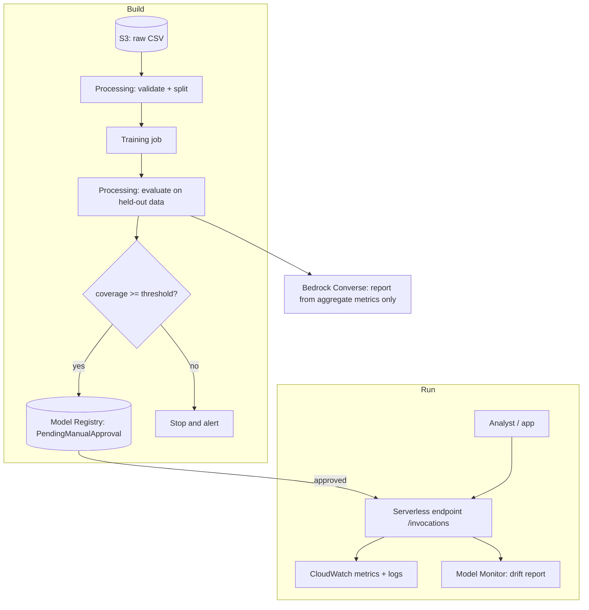

# Architecture

## Components

| Layer | Service | Why |
| --- | --- | --- |
| Storage | **Amazon S3** (private, versioned, SSE) | raw extracts, pipeline outputs, model artefacts |
| Orchestration | **SageMaker Pipelines** | repeatable prepare -> train -> evaluate -> gate -> register |
| Training / processing | **SageMaker** (scikit-learn container, script mode) | no custom image needed; small CPU jobs |
| Registry | **SageMaker Model Registry** | versioned models with a *manual approval* step |
| Serving | **SageMaker serverless inference** | scales to zero; imputation is bursty and light |
| Reporting | **Amazon Bedrock** (Converse API, optional Guardrail) | turns aggregate metrics into plain English |
| Observability | **CloudWatch**, **Model Monitor** | latency/errors, input drift |
| Security | IAM least privilege, S3 block-public-access, KMS optional | see DATA_GOVERNANCE.md |
| Cost | **AWS Budgets** + serverless + delete scripts | see DEPLOY_AWS.md |

## Flow

## Key design decisions

1. **Multiple, not single, imputation.** The endpoint returns the mean and the 5th-95th percentile across
   m draws, so downstream analyses can propagate uncertainty (Rubin's rules are in `pooling.py`).
2. **Default model is parametric (`norm`).** It stores only coefficients, so the artefact contains no
   personal data. Donor methods (`pmm`, `cart`, `rf`) often do better under non-linearity but embed real
   wages; use them only inside a controlled environment.
3. **Quality gate before registry.** The pipeline only registers a model when simulated coverage of the 95%
   interval is at least the `MinCoverage` parameter (default 0.90). A person still approves it.
4. **Bedrock sees aggregates only.** `bedrock_report.assert_aggregate_only` rejects row-level looking input.
5. **One interface everywhere.** The same `ImputationModel.predict_records` is used by the CLI, the FastAPI
   container, and the SageMaker `inference.py`.
6. **Serverless first.** An always-on endpoint would cost more than the whole workload needs.

## Alternatives considered

* *Real-time endpoint on `ml.m5.large`*: simpler cold-start behaviour but about 24/7 cost.
* *Batch Transform*: good for nightly surveys; not implemented yet (the model already supports DataFrames).
* *LLM-based imputation*: rejected: no calibrated uncertainty, privacy risk, hard to validate.
