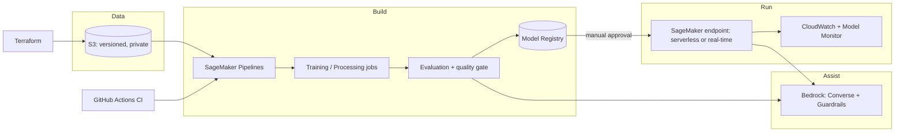

# Machine-learning platform strategy (shared by both projects)

Two earlier academic projects are being rebuilt as production-style solutions on AWS:

| Project | Original | Problem type | Repository |
| --- | --- | --- | --- |
| Income imputation | BSc, University of Essex, R + `mice` | tabular, statistical inference under missing data | `income-imputation-aws` |
| Abnormality detection | MSc, University of Southampton, Keras VGG-16 | medical-image classification + anomaly score | `abnormality-detection-aws` |

## 1. Principles

1. **Validity before accuracy.** Statistical validity for imputation (coverage, bias); clinical safety and
   honest evaluation for imaging (video-level splits, per-class recall, calibration).
2. **Human in the loop.** Models propose, people decide. Registry approval is manual.
3. **Reproducible by default.** Everything runs from a clean clone with synthetic data and no cloud account;
   AWS adds scale, governance and deployment.
4. **Privacy by construction.** No real data in git; small artefacts; no identifiers in logs or prompts.
5. **Cost-aware.** Serverless where possible, budgets, and delete scripts for anything always-on.
6. **Foundation models as assistants, not decision makers.** Bedrock writes explanations from aggregate
   outputs and never sees raw rows or images.

## 2. Target architecture

## 3. AWS service map

| Need | Service used here | Next to explore |
| --- | --- | --- |
| Storage and lineage | S3 (versioning, SSE) | Lake Formation, data catalogue |
| Experiments and training | SageMaker training jobs, script mode | managed spot training, hyper-parameter tuning, Experiments |
| Orchestration | SageMaker Pipelines | EventBridge schedules for re-training |
| Governance | Model Registry, IAM least privilege, Budgets | Model Cards in SageMaker, Service Catalog |
| Bias / explainability | (planned) | SageMaker Clarify, Grad-CAM for images |
| Serving | serverless inference, real-time endpoints, ONNX | Async inference, multi-model endpoints, Neo |
| Monitoring | CloudWatch, Model Monitor (documented) | data-quality and drift schedules, alarms to SNS |
| Generative AI | Bedrock Converse + Guardrails | Knowledge Bases over the model docs, Bedrock model evaluation |
| IaC and CI/CD | Terraform, GitHub Actions | CodePipeline, OIDC role for GitHub to AWS (no long-lived keys) |

## 4. Standards for every project

* Package with `pyproject.toml`, CLI, tests (pytest), lint (ruff), CI on every push.
* Synthetic-data demo that runs on CPU in about a minute.
* `docs/`: architecture, ML strategy, data governance, deployment, "from the thesis" mapping, honest limitations.
* Quality gate in the pipeline, manual approval in the registry.
* Tags and a monthly budget alarm on every stack.
* README states plainly what has and has not been verified.

## 5. Roadmap

| Phase | Weeks | Outcome |
| --- | --- | --- |
| 0 Local, tested | done | both repositories pass their tests on CPU |
| 1 First AWS run | 1-2 | Terraform applied in a sandbox account; imputation pipeline runs end to end; endpoint invoked and deleted |
| 2 Imaging on AWS | 3-4 | Kvasir-Capsule in S3; GPU training job; honest re-baseline of the thesis; quality gate tuned |
| 3 Monitoring and CI/CD | 5-6 | Model Monitor baselines; GitHub OIDC deploys; alarms |
| 4 Improve the models | 7-10 | imaging: unfreeze/alternative backbones, one-class comparison, Grad-CAM; imputation: real-data run inside the licensed environment, MNAR sensitivity |
| 5 Generative AI | 11-12 | Bedrock Guardrails tuned, evaluation of generated notes by a human reviewer, Knowledge Base over docs |

## 6. How success is measured

* Imputation: coverage >= 90% for every estimand under MAR, bias within 1-2%.
* Imaging: abnormal recall >= 85% at a stated review burden, macro-F1 reported per class, ECE < 0.10,
  with external validation before any generalisation claim.
* Platform: a new model goes from commit to registered candidate without manual steps; every always-on
  resource has an owner, a tag and a deletion path.

## 7. Honest status

* Code and tests: complete for local use (imputation 56 tests, imaging 37 tests).
* AWS deployment code: written, **unverified on a live account**.
* Imaging model: **not retrained on the real dataset** in this repository; no accuracy claim is made.
* Imputation: results are on **synthetic** data; the licensed real extract must be used inside its own
  environment.
